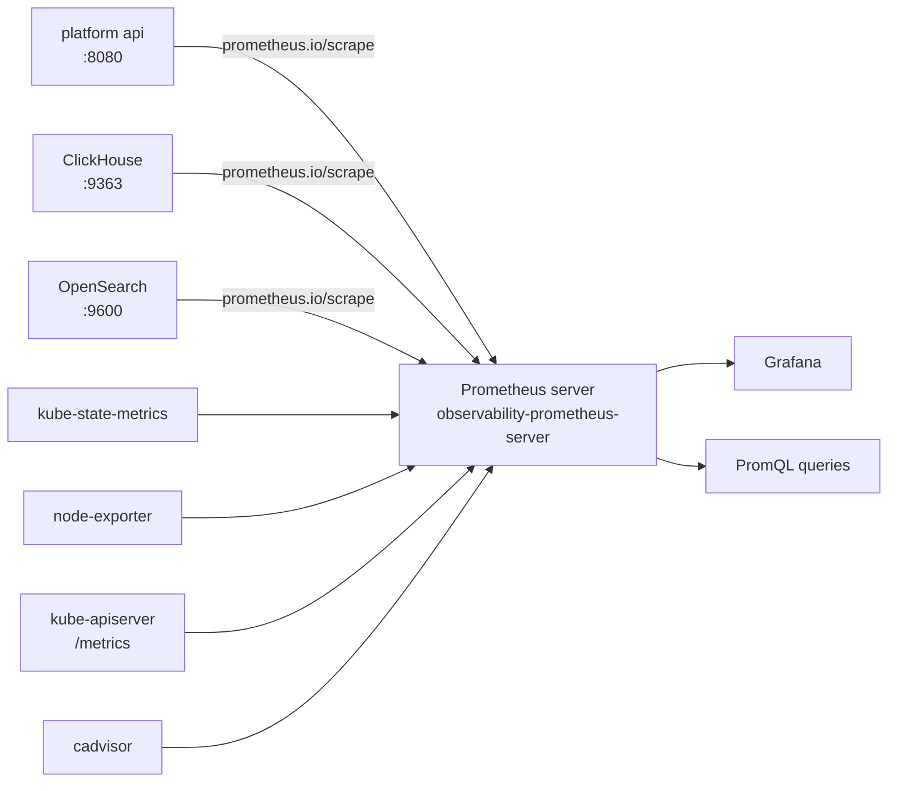
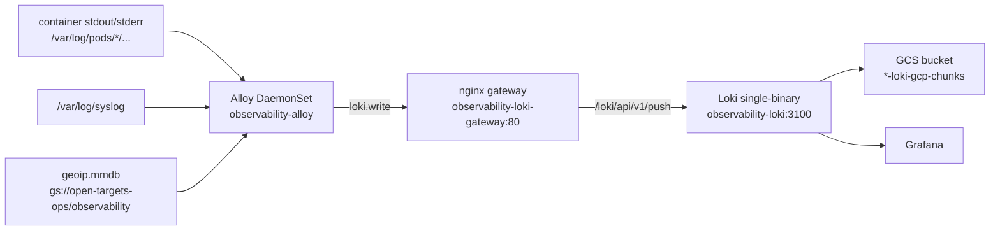

# Observability stack

Reference documentation for the Open Targets observability stack: what runs, how data
flows through it, and where to change things.

- **[runbook.md](runbook.md)** — deployment commands, diagnostics, and a symptom-to-cause
  triage table.

The stack is deployed by ArgoCD from `helm/observability/`. The shared configuration lives in
`helm/observability/values.yaml`; every value that differs per environment lives in
`profiles/<environment>/observability.yaml`.

## Components at a glance

The observability chart (`helm/observability/`) depends on four upstream charts. Each is
pinned to an exact version in `helm/observability/Chart.yaml` and resolved through
`Chart.lock`.

| Chart        | Version | Repository                                           | Provides                                                                           |
| ------------ | ------- | ---------------------------------------------------- | ---------------------------------------------------------------------------------- |
| `prometheus` | 27.39.0 | `https://prometheus-community.github.io/helm-charts` | Prometheus server, node-exporter, pushgateway, kube-state-metrics                  |
| `grafana`    | 10.5.15 | `https://grafana.github.io/helm-charts`              | Grafana, with the dashboard and datasource sidecars                                |
| `loki`       | 7.0.0   | `https://grafana.github.io/helm-charts`              | Loki in single-binary mode, the nginx gateway, the canary and the memcached caches |
| `alloy`      | 1.8.0   | `https://grafana.github.io/helm-charts`              | Alloy, which collects and enriches logs                                            |

Prometheus and Loki each run a single replica. Their PVCs are `30Gi` and `12Gi` on the
`hyperdisk-balanced` storage class respectively. Loki's data is stored in buckets instead of the PVC.

## Architecture

### Metrics



Prometheus scrapes annotated Services and pods directly via `kubernetes_sd_configs`. For the Platform resources discovery is driven by `prometheus.io/scrape` annotations
on the Services in `helm/platform/templates/services.yaml`.

### Logs



Alloy runs as a DaemonSet on every non-staging node and tails both the node's `/var/log/syslog`
and the container log files of every pod on that node. It writes to the Loki **gateway** (an nginx
reverse proxy), not to Loki directly — the gateway terminates the HTTP path and forwards to the
single-binary Loki pod.

The data uses the `geoip.mmdb` database to enrich the logs with locations based on IP addresses.

## Deployment and placement

Every observability component runs on the dedicated `ops` GKE node pool.

Defined in `terraform/main.tf:162-220`:

- Node pool name: `${var.global_prefix}-ops`
- Node label: `pool: ops`
- Taint: `workload=ops:NO_SCHEDULE`

Components that must run on that pool set a required node affinity on `pool In [ops]` and a
toleration for `workload=ops:NoSchedule`. Alloy and node-exporter instead use `pool NotIn
[staging]`, so they run everywhere except the staging pool — they need per-node coverage, and
the staging pool runs no platform workloads.

The `ops` pool starts with a single node and autoscales between `var.ops_min_node_count` and
`var.ops_max_node_count`. Those variables have no default in `terraform/variables.tf:81-89`, so
the pool size is supplied in the `devculster` and `production` profiles.

## Delivery model

Two ArgoCD `Application` resources manage the stack:

| Application     | File                                   | Cluster                            | Values file                               |
| --------------- | -------------------------------------- | ---------------------------------- | ----------------------------------------- |
| `observability` | `argocd/devcluster-observability.yaml` | devcluster (`open-targets-eu-dev`) | `/profiles/devcluster/observability.yaml` |
| `observability` | `argocd/production-observability.yaml` | production (`open-targets-prod`)   | `/profiles/production/observability.yaml` |

Both point at `path: helm/observability` with `targetRevision: main`. Neither defines a
`syncPolicy` block, so both inherit ArgoCD's default of automated sync with pruning and
self-healing. A merge to `main` is therefore applied to the cluster without an explicit
`argocd app sync`.

## Metrics pipeline

### Scrape jobs

Configured under `prometheus.serverFiles.prometheus.yml.scrape_configs`. The base file
`helm/observability/values.yaml` defines all ten jobs; the profile files do not redefine
the list, because Helm replaces lists wholesale rather than merging them element by element.

| Job                                 | What it scrapes                                              |
| ----------------------------------- | ------------------------------------------------------------ |
| `prometheus`                        | Prometheus itself                                            |
| `kubernetes-apiservers`             | The kube-apiserver `/metrics` endpoint                       |
| `kubernetes-nodes`                  | node-exporter on each node                                   |
| `kubernetes-nodes-cadvisor`         | The kubelet's cadvisor endpoint on each node                 |
| `kubernetes-service-endpoints`      | Every annotated Service endpoint, at a short interval        |
| `kubernetes-service-endpoints-slow` | The same endpoints, at a longer interval                     |
| `prometheus-pushgateway`            | The pushgateway                                              |
| `kubernetes-services`               | HTTP probes of annotated Services via `blackbox-exporter`    |
| `kubernetes-pods`                   | Every annotated pod, at a short interval                     |
| `kubernetes-pods-slow`              | The same pods, at a longer interval                          |
| `opensearch`                        | OpenSearch's `/_prometheus/metrics` endpoint                 |

The `-slow` variants exist to reduce scrape volume: the fast jobs sample frequently for
short-lived workloads, the slow jobs provide a lower-resolution history for the same targets.

### Relabel logic

The `kubernetes-service-endpoints` and `kubernetes-pods` jobs carry the logic that determines
which series exist. This is not obvious from reading the YAML alone, so it is worth stating
plainly:

- **Staging is excluded.** A `drop` rule matches `.*staging.*` against the service, pod and
  node names, so staging workloads never enter production's metrics. The same exclusion
  appears as a `metric_relabel_configs` drop on `^staging$` for the `environment` label.
- **PPP is excluded from the platform metrics.** The `opensearch` and ClickHouse endpoints
  drop the partner-platform traffic.
- **`node_environment` is derived from the GKE node name.** The relabel rules extract
  `production`, `staging` or `ops` from the node name and attach it as the
  `node_environment` label. Most dashboard queries filter on
  `node_environment="production"`, because the cluster also hosts staging nodes.
- **`honor_labels: true`** is set on the endpoint and pod jobs, so a target's own labels win
  over the labels Prometheus would otherwise attach.

## Logs pipeline

### Alloy

Alloy's configuration lives inline in the `alloy.alloy.configMap.content` key of the values
files. It defines two independent pipelines that both terminate at `loki.write "default"`.

**`node_logs`** reads `/var/log/syslog` and tags it with `log_source = "node_logs"`.

**`pod_logs`** uses `discovery.kubernetes` with `role = "pod"`, scoped to pods on the local
node (`spec.nodeName = $HOSTNAME`), then relabels the discovered targets into log labels. The
`__path__` is derived from the pod UID and container name to reach
`/var/log/pods/*<uid>/*.log`.

Both pipelines apply `stage.drop` rules that exclude infrastructure containers — Loki,
manager, Grafana, Alloy, konnectivity-agent, GKE metadata server, Calico, prom-to-sd,
recorder, secrets-store, dnsmasq and others — plus a rule dropping the `observability/loki`
job so Loki does not ingest its own logs.

Pod logs additionally pass through:

- `stage.json`, extracting `client_ip` from the JSON log body
- `stage.geoip`, resolving `client_ip` to a country using the GeoIP database
- `stage.structured_metadata`, attaching the resolved GeoIP fields

The geolocation information is passed as structured metadata in order to avoid un necessary increases in the cardinality of the logs.

### GeoIP database

An init container (`geoip-init`) downloads the MaxMind database from
`gs://open-targets-ops/observability/geoip.mmdb` into `/geoip`. It uses the `gcloud-sdk`
image and retries up to five times. The file is mounted into the Alloy container via
`alloy.mounts.extra`.

This database is generated using the tool [platform-deployment-ipdb-transformer](https://github.com/opentargets/platform-deployment-ipdb-transformer). This tool is being runned manually using github actions, in the future it could be automatically runned every week or so.

## Loki storage

| Setting            | Value                                                       |
| ------------------ | ----------------------------------------------------------- |
| Schema             | TSDB, `v13`                                                 |
| Object store       | GCS                                                         |
| Index prefix       | `loki_index_`                                               |
| Index period       | `24h`                                                       |
| Schema start date  | `2024-04-01`                                                |
| Chunks bucket      | `devcluster-loki-gcp-chunks` / `production-loki-gcp-chunks` |
| Ruler bucket       | `devcluster-loki-gcp-ruler` / `production-loki-gcp-ruler`   |
| Replication factor | `1`                                                         |

The buckets are created in Terraform (`terraform/main.tf:437-473`) with a 30-day lifecycle
delete rule, and are exposed as outputs in `terraform/outputs.tf:2-13`.

Loki accesses GCS through Workload Identity rather than static keys. The `loki-sa` service
account is annotated with the GKE service account for the environment
(`profiles/production/observability.yaml`), and the IAM binding granting
`roles/storage.objectViewer` on the `open-targets-ops` bucket to the node service account
is defined in `terraform/security.tf:127-133`. That binding is applied only in the
production project (`count = var.project_id == "open-targets-prod" ? 1 : 0`).

## Dashboards

### OT Dash

The dashboard is defined in the file `helm/observability/dashboards/ot-dashboard.json`. The dashboard uid `dde21982-294c-47be-b5ee-032de07f75a6`.

It is provisioned by sidecar rather than by a Grafana provisioning file:

1. `helm/observability/templates/configmaps.yaml` creates a ConfigMap containing the
   dashboard JSON, labelled `grafana_dashboard: ot-dashboard`.
2. `helm/observability/templates/secrets.yaml` creates a Secret containing the datasource
   definitions, labelled `grafana_datasource: ot-dashboard`.
3. Grafana's dashboard and datasource sidecars watch for those labels and load the contents
   into the running instance.

Two datasources are defined:

| Name       | Type         | UID                    | URL                                                                 |
| ---------- | ------------ | ---------------------- | ------------------------------------------------------------------- |
| Prometheus | `prometheus` | `prometheusdatasource` | `http://observability-prometheus-server.observability.svc:80`       |
| Loki       | `loki`       | _(none)_               | `http://observability-loki-gateway.observability.svc.cluster.local` |

The Loki datasource sends `X-Scope-OrgID: default` on every request.

The grafana password can be obtained at any time by using:

``` bash
make get-password-grafana
```

### Panels

| Panel                    | Source     | Question it answers                                                  |
| ------------------------ | ---------- | -------------------------------------------------------------------- |
| Node status              | Prometheus | Which nodes are up?                                                  |
| CPU usage                | Prometheus | How loaded are the nodes?                                            |
| Memory usage             | Prometheus | How much memory is in use?                                           |
| Requests source          | Loki       | Map visualisation of where do API requests come from geographically? |
| Top 10 queries Increase  | Prometheus | Which GraphQL queries are most used?                                 |
| Log level API            | Loki       | How many API log lines at each level (Ex. ERROR, DEBUG,...)?         |
| Top 5 Countries          | Loki       | Which countries send the most API requests?                          |
| _Row: API_               |            |                                                                      |
| CPU load                 | Prometheus | How much CPU is the API consuming?                                   |
| GraphQL requests         | Prometheus | Request rate per instance                                            |
| DB requests              | Prometheus | Database query rate per database                                     |
| Cache hit per query name | Prometheus | Which queries miss the cache most?                                   |
| Cache hit rate           | Prometheus | Overall cache effectiveness                                          |
| _Row: k8s nodes_         |            |                                                                      |
| CPU usage                | Prometheus | Per-node CPU                                                         |
| Memory usage             | Prometheus | Per-node memory                                                      |
| Network activity         | Prometheus | Per-node receive/transmit rates                                      |
| Traffic drop             | Prometheus | Per-node dropped packets                                             |

The dashboard has no template variables, so there is no environment or cluster selector — it
always shows the cluster it is deployed in.

## Alerting

Grafana provisions the **OT Slack** contact point from
`grafana.alerting.contactpoints.yaml` in the shared values.

Both clusters read `projects/open-targets-eu-dev/secrets/slack-token/versions/latest`.
The GKE Secret Manager CSI driver mounts it at `/mnt/secrets/slack/slack_token` in
Grafana. The startup command reads that file into `slack_token` before invoking
Grafana's normal `/run.sh` entrypoint, so alerting provisioning can expand `$slack_token`.
No Slack token value is stored in Helm values or a chart-managed Kubernetes Secret.

The `grafana-sa` Kubernetes service account in namespace `observability` is granted
`roles/secretmanager.secretAccessor` on that single shared secret by
`google_secret_manager_secret_iam_member.grafana_slack_token` in `terraform/security.tf`.
Each environment's Terraform state grants its own cluster identity access, including
production's cross-project access to eu-dev.

See [Slack setup and token rotation](runbook.md#slack-setup-and-token-rotation) for rollout
order and verification.

## Environment differences

The shared configuration lives in `helm/observability/values.yaml` and is identical for both
environments. The profile files override only the following values.

| Setting                        | devcluster                                                    | production                                                  |
| ------------------------------ | ------------------------------------------------------------- | ----------------------------------------------------------- |
| Loki chunks bucket             | `devcluster-loki-gcp-chunks`                                  | `production-loki-gcp-chunks`                                |
| Loki ruler bucket              | `devcluster-loki-gcp-ruler`                                   | `production-loki-gcp-ruler`                                 |
| Workload Identity GSA          | `devcluster-node@open-targets-eu-dev.iam.gserviceaccount.com` | `production-node@open-targets-prod.iam.gserviceaccount.com` |
| `cluster` label (node logs)    | `dev_cluster`                                                 | `production`                                                |
| `cluster` label (pod logs)     | `devcluster`                                                  | `production`                                                |

The two `cluster` labels are set through `global.cluster` and `global.nodeLogsCluster` in the
profile, and are substituted into the Alloy configuration in the base file.

The `local` (minikube) environment has **no** observability deployment. There is no
`profiles/local/observability.yaml` and no ArgoCD Application for it.

## Editing the stack

1. Edit `helm/observability/values.yaml` if the change applies to **every** environment. Edit
   the **profile** file — `profiles/devcluster/observability.yaml` or
   `profiles/production/observability.yaml` — if it applies to one environment only.
2. Keep lists whole. Helm replaces a list instead of merging it element by element, so a
   profile that redefines `prometheus.serverFiles.prometheus.yml.scrape_configs` loses the
   shared list rather than adding to it. The same applies to `tolerations` and `affinity`.
3. Validate locally:
   ```bash
   helm lint helm/observability -f profiles/production/observability.yaml
   helm template observability helm/observability \
     -f profiles/production/observability.yaml --namespace observability
   ```
4. Commit and merge to `main`. ArgoCD syncs both environments automatically.

## Out of scope

This document covers the observability stack only. It does not cover Terraform provisioning of the GKE clusters, node pools and GCS buckets.
