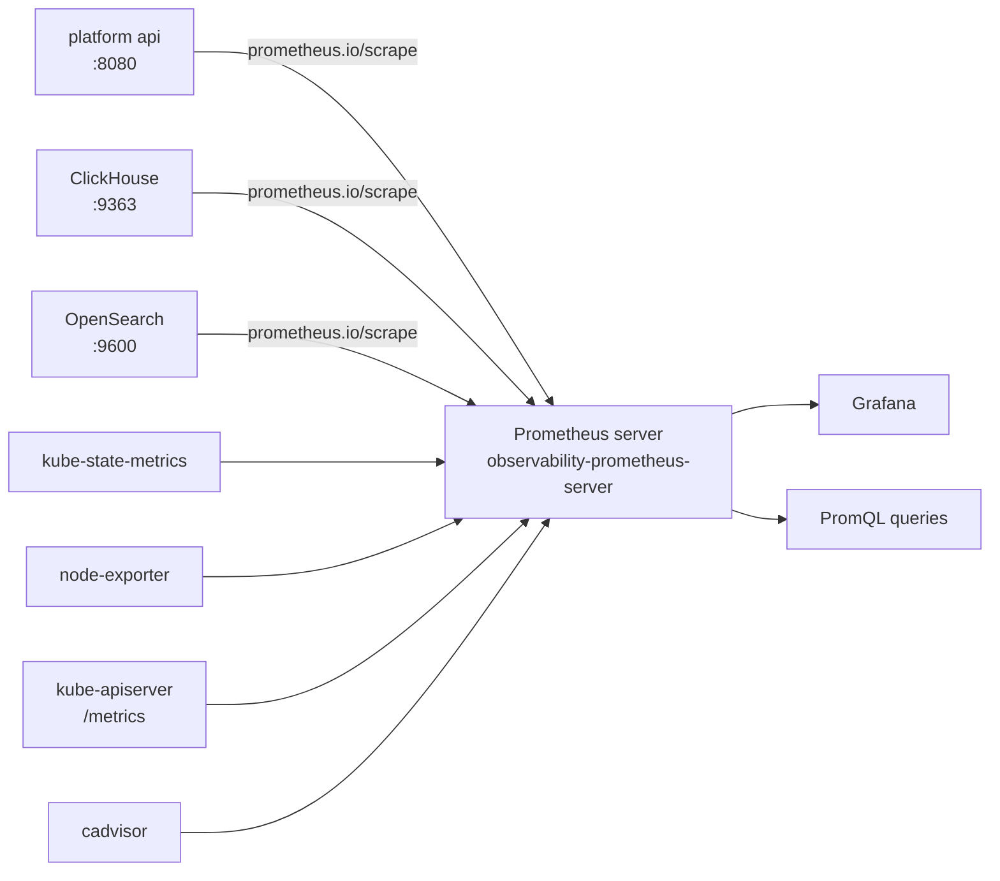
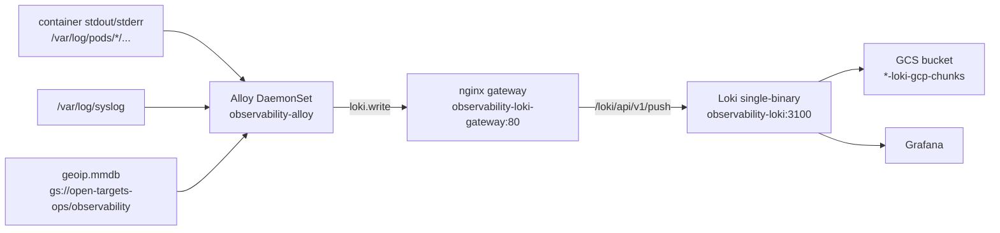

# Observability stack

Reference documentation for the Open Targets observability stack: what runs, how data
flows through it, and where to change things.

- **[gaps.md](gaps.md)** — known issues in the current configuration, with severity and
  proposed fixes.
- **[runbook.md](runbook.md)** — deployment commands, diagnostics, and a symptom-to-cause
  triage table.

The stack is deployed by ArgoCD from `helm/observability/`. Every value that differs per
environment lives in `profiles/<environment>/observability.yaml`.

## Components at a glance

| Component | Chart | Version | Deployment | Replicas | Placement |
|---|---|---|---|---|---|
| Prometheus | `prometheus` | 27.39.0 | Deployment (`observability-prometheus-server`) | 1 | `pool: ops` |
| Grafana | `grafana` | 10.5.15 | Deployment (`observability-grafana`) | 1 | `pool: ops` |
| Loki | `loki` | 7.0.0 | StatefulSet (`observability-loki`), `deploymentMode: SingleBinary` | 1 | `pool: ops` |
| Loki gateway | `loki` (nginx) | 7.0.0 | Deployment (`observability-loki-gateway`) | 1 | `pool: ops` |
| Grafana Alloy | `alloy` | 1.8.0 | DaemonSet (`observability-alloy`) | 1 per node | `pool NotIn [staging]` |
| kube-state-metrics | `prometheus` (subchart) | 27.39.0 | Deployment (`observability-kube-state-metrics`) | 1 | `pool: ops` |
| node-exporter | `prometheus` (subchart) | 27.39.0 | DaemonSet (`observability-prometheus-node-exporter`) | 1 per node | `pool NotIn [staging]` |
| pushgateway | `prometheus` (subchart) | 27.39.0 | Deployment (`observability-prometheus-pushgateway`) | 1 | `pool: ops` |
| Loki canary | `loki` (subchart) | 7.0.0 | DaemonSet (`loki-canary`) | 1 | `pool: ops` |
| Loki chunks cache | `loki` (subchart) | 7.0.0 | StatefulSet (`observability-loki-chunks-cache`) | 1 | `pool: ops` |
| Loki results cache | `loki` (subchart) | 7.0.0 | StatefulSet (`observability-loki-results-cache`) | 1 | `pool: ops` |

Prometheus and Loki each run a single replica. Their PVCs are `30Gi` and `12Gi` on the
`hyperdisk-balanced` storage class respectively.

## Architecture

### Metrics



Prometheus scrapes annotated Services and pods directly via `kubernetes_sd_configs`. There
is no Prometheus Operator in this stack, so there are no `ServiceMonitor` / `PodMonitor` /
`PrometheusRule` custom resources — discovery is driven by `prometheus.io/scrape` annotations
on the Services in `helm/platform/templates/services.yaml`.

### Logs



Alloy runs as a DaemonSet on every non-staging node and tails both the node's `/var/log/syslog`
and the container log files of every pod on that node. It writes to the Loki **gateway** (an nginx
reverse proxy), not to Loki directly — the gateway terminates the HTTP path and forwards to the
single-binary Loki pod.

## Deployment and placement

Every observability component runs on the dedicated `ops` GKE node pool.

Defined in `terraform/main.tf:162-220`:

- Node pool name: `${var.global_prefix}-ops`
- Node label: `pool: ops`
- Taint: `workload=ops:NO_SCHEDULE`

Components that must run on that pool set a required node affinity on `pool In [ops]` and a
toleration for `workload=ops:NoSchedule`. Alloy and node-exporter instead use `pool NotIn
[staging]`, so they run everywhere except the staging pool — they need per-node coverage, and
the staging pool runs no platform workloads.

The `ops` pool starts with a single node and autoscales between `var.ops_min_node_count` and
`var.ops_max_node_count`. Those variables have no default in `terraform/variables.tf:81-89`, so
the pool size is supplied outside the repository.

## Delivery model

Two ArgoCD `Application` resources manage the stack:

| Application | File | Cluster | Values file |
|---|---|---|---|
| `observability` | `argocd/devcluster-observability.yaml` | devcluster (`open-targets-eu-dev`) | `/profiles/devcluster/observability.yaml` |
| `observability` | `argocd/production-observability.yaml` | production (`open-targets-prod`) | `/profiles/production/observability.yaml` |

Both point at `path: helm/observability` with `targetRevision: main`. Neither defines a
`syncPolicy` block, so both inherit ArgoCD's default of automated sync with pruning and
self-healing. A merge to `main` is therefore applied to the cluster without an explicit
`argocd app sync`.

There is no CI pipeline in this repository. The `Makefile` targets in
[runbook.md](runbook.md) apply the ArgoCD `Application` resources; ArgoCD does the rest.

## Metrics pipeline

### Scrape jobs

Configured under `prometheus.serverFiles.prometheus.yml.scrape_configs`. The base file
`helm/observability/values.yaml:98-369` defines ten jobs; both profile files add an
`opensearch` job.

| Job | What it scrapes |
|---|---|
| `prometheus` | Prometheus itself |
| `kubernetes-apiservers` | The kube-apiserver `/metrics` endpoint |
| `kubernetes-nodes` | node-exporter on each node |
| `kubernetes-nodes-cadvisor` | The kubelet's cadvisor endpoint on each node |
| `kubernetes-service-endpoints` | Every annotated Service endpoint, at a short interval |
| `kubernetes-service-endpoints-slow` | The same endpoints, at a longer interval |
| `prometheus-pushgateway` | The pushgateway |
| `kubernetes-services` | HTTP probes of annotated Services via `blackbox-exporter` |
| `kubernetes-pods` | Every annotated pod, at a short interval |
| `kubernetes-pods-slow` | The same pods, at a longer interval |
| `opensearch` | OpenSearch's `/_prometheus/metrics` endpoint (profiles only) |

The `-slow` variants exist to reduce scrape volume: the fast jobs sample frequently for
short-lived workloads, the slow jobs provide a lower-resolution history for the same targets.

### Relabel logic

The `kubernetes-service-endpoints` and `kubernetes-pods` jobs carry the logic that determines
which series exist. This is not obvious from reading the YAML alone, so it is worth stating
plainly:

- **Staging is excluded.** A `drop` rule matches `.*staging.*` against the service, pod and
  node names, so staging workloads never enter production's metrics. The same exclusion
  appears as a `metric_relabel_configs` drop on `^staging$` for the `environment` label.
- **PPP is excluded from the platform metrics.** The `opensearch` and ClickHouse endpoints
  drop the partner-platform traffic.
- **`node_environment` is derived from the GKE node name.** The relabel rules extract
  `production`, `staging` or `ops` from the node name and attach it as the
  `node_environment` label. Most dashboard queries filter on
  `node_environment="production"`, because the cluster also hosts staging nodes.
- **`honor_labels: true`** is set on the endpoint and pod jobs, so a target's own labels win
  over the labels Prometheus would otherwise attach.

### Metrics labels

| Label | Set by | Example |
|---|---|---|
| `job` | The scrape job name | `kubernetes-pods` |
| `instance` | The scrape target address | `10.0.1.14:8080` |
| `namespace` | Kubernetes namespace of the target | `platform` |
| `pod` | Pod name | `platform-api-7d9f8c4b6-x2k9p` |
| `node` / `nodename` | Node name | `gke-open-targets-prod-ops-1` |
| `service` | Kubernetes service name | `platform-api` |
| `container` | Container name | `api` |
| `node_environment` | Derived from the node name by relabel rules | `production` |
| `query_name` | Emitted by the API's GraphQL instrumentation | `targetsByIds` |
| `database` | Emitted by the API's database instrumentation | `clickhouse` |
| `area` | JVM metrics, where `area="heap"` selects heap usage | `heap` |

## Logs pipeline

### Alloy

Alloy's configuration lives inline in the `alloy.alloy.configMap.content` key of the values
files. It defines two independent pipelines that both terminate at `loki.write "default"`.

**`node_logs`** reads `/var/log/syslog` and tags it with `log_source = "node_logs"`.

**`pod_logs`** uses `discovery.kubernetes` with `role = "pod"`, scoped to pods on the local
node (`spec.nodeName = $HOSTNAME`), then relabels the discovered targets into log labels. The
`__path__` is derived from the pod UID and container name to reach
`/var/log/pods/*<uid>/*.log`.

Both pipelines apply `stage.drop` rules that exclude infrastructure containers — Loki,
manager, Grafana, Alloy, konnectivity-agent, GKE metadata server, Calico, prom-to-sd,
recorder, secrets-store, dnsmasq and others — plus a rule dropping the `observability/loki`
job so Loki does not ingest its own logs.

Pod logs additionally pass through:

- `stage.json`, extracting `client_ip` from the JSON log body
- `stage.geoip`, resolving `client_ip` to a country using the GeoIP database
- `stage.structured_metadata`, attaching the resolved GeoIP fields

### GeoIP database

An init container (`geoip-init`) downloads the MaxMind database from
`gs://open-targets-ops/observability/geoip.mmdb` into `/geoip`. It uses the `gcloud-sdk`
image and retries up to five times. The file is mounted into the Alloy container via
`alloy.mounts.extra`.

### Log labels

| Label | Set by | Example |
|---|---|---|
| `namespace` | `discovery.relabel` from the pod's namespace | `platform` |
| `pod` | `discovery.relabel` from the pod name | `platform-api-7d9f8c4b6-x2k9p` |
| `container` | `discovery.relabel` from the container name | `api` |
| `job` | `discovery.relabel`, `namespace/container` | `platform/api` |
| `cluster` | `stage.static_labels` | `production_cluster` |
| `log_source` | `stage.static_labels`, node logs only | `node_logs` |
| `container_runtime` | `discovery.relabel` from the pod container ID | `containerd` |
| `detected_level` | Loki's pattern ingester, not Alloy | `error` |

> The platform API's container is named `api`, so `{container="api"}` is the selector to use
> for API logs. The `app` label is populated from the pod's `app.kubernetes.io/name` label,
> which platform workloads do not set, so it is empty for them.

`detected_level` is Loki's own structured metadata, produced by the pattern ingester. It is
enabled in both profiles (`pattern_ingester.enabled: true`) and is queryable as a pipeline
filter, e.g. `| detected_level != ""`. It is not a stream label, so it cannot be used in the
`{...}` selector.

## Loki storage

| Setting | Value |
|---|---|
| Schema | TSDB, `v13` |
| Object store | GCS |
| Index prefix | `loki_index_` |
| Index period | `24h` |
| Schema start date | `2024-04-01` |
| Chunks bucket | `devcluster-loki-gcp-chunks` / `production-loki-gcp-chunks` |
| Ruler bucket | `devcluster-loki-gcp-ruler` / `production-loki-gcp-ruler` |
| Replication factor | `1` |

The buckets are created in Terraform (`terraform/main.tf:437-473`) with a 30-day lifecycle
delete rule, and are exposed as outputs in `terraform/outputs.tf:2-13`.

Loki accesses GCS through Workload Identity rather than static keys. The `loki-sa` service
account is annotated with the GKE service account for the environment
(`profiles/production/observability.yaml:471-475`), and the IAM binding granting
`roles/storage.objectViewer` on the `open-targets-ops` bucket to the node service account
is defined in `terraform/security.tf:127-133`. That binding is applied only in the
production project (`count = var.project_id == "open-targets-prod" ? 1 : 0`).

## Dashboards

A single dashboard is deployed: **`OT Dash`**, uid `dde21982-294c-47be-b5ee-032de07f75a6`,
in `helm/observability/dashboards/ot-dashboard.json`.

It is provisioned by sidecar rather than by a Grafana provisioning file:

1. `helm/observability/templates/configmaps.yaml` creates a ConfigMap containing the
   dashboard JSON, labelled `grafana_dashboard: ot-dashboard`.
2. `helm/observability/templates/secrets.yaml` creates a Secret containing the datasource
   definitions, labelled `grafana_datasource: ot-dashboard`.
3. Grafana's dashboard and datasource sidecars watch for those labels and load the contents
   into the running instance.

Two datasources are defined:

| Name | Type | UID | URL |
|---|---|---|---|
| Prometheus | `prometheus` | `prometheusdatasource` | `http://observability-prometheus-server.observability.svc:80` |
| Loki | `loki` | *(none)* | `http://observability-loki-gateway.observability.svc.cluster.local` |

The Loki datasource sends `X-Scope-OrgID: default` on every request.

### Panels

| Panel | Source | Question it answers |
|---|---|---|
| Node status | Prometheus | Which nodes are up? |
| CPU usage | Prometheus | How loaded are the nodes? |
| Memory usage | Prometheus | How much memory is in use? |
| Requests source | Loki | Where do API requests come from geographically? |
| Top 10 queries Increase | Prometheus | Which GraphQL queries are most used? |
| Log level API | Loki | How many API log lines at each level? |
| Top 5 Countries | Loki | Which countries send the most API requests? |
| *Row: API* | | |
| Heap memory usage | Prometheus | How much of the JVM heap is used? |
| Max Heap Memory | Prometheus | What is the heap ceiling? |
| CPU load | Prometheus | How much CPU is the API consuming? |
| JVM heap | Prometheus | Heap usage over time |
| GraphQL requests | Prometheus | Request rate per instance |
| DB requests | Prometheus | Database query rate per database |
| Cache hit per query name | Prometheus | Which queries miss the cache most? |
| Cache hit rate | Prometheus | Overall cache effectiveness |
| *Row: k8s nodes* | | |
| CPU usage | Prometheus | Per-node CPU |
| Memory usage | Prometheus | Per-node memory |
| Network activity | Prometheus | Per-node receive/transmit rates |
| Traffic drop | Prometheus | Per-node dropped packets |

The dashboard has no template variables, so there is no environment or cluster selector — it
always shows the cluster it is deployed in.

## Alerting

The stack currently has **no alerting**. Alertmanager is disabled
(`alertmanager.enabled: false` in all three values files), and there are no alert rules: the
`alerting_rules.yml`, `recording_rules.yml`, `rules` and `alerts` keys of the Prometheus
ConfigMap all render empty.

The Loki ruler is enabled and points at an Alertmanager that is not deployed — see
[G2 in gaps.md](gaps.md). There are no ruler rules either.

## Tracing

There is **no tracing stack**. There is no Tempo, no OpenTelemetry Collector, no Jaeger, and
no OTLP receiver anywhere in the repository. The only trace-adjacent setting is ClickHouse's
`<trace_log>` TTL in `helm/platform/files/clickhouse/config.xml:47-49`.

Adding tracing would require:

1. A Tempo deployment, or a Loki 3.x deployment using the Loki native OTLP ingest path.
2. An OpenTelemetry Collector to receive OTLP from the applications and export to the trace
   backend.
3. An `otelcol.receiver` in the Alloy configuration, or a separate Collector deployment.
4. Instrumentation in the platform API to emit spans.

## Environment differences

The devcluster and production values files differ in the following ways. Everything else is
identical.

| Setting | devcluster | production |
|---|---|---|
| Loki chunks bucket | `devcluster-loki-gcp-chunks` | `production-loki-gcp-chunks` |
| Loki ruler bucket | `devcluster-loki-gcp-ruler` | `production-loki-gcp-ruler` |
| Workload Identity GSA | `devcluster-node@open-targets-eu-dev.iam.gserviceaccount.com` | `production-node@open-targets-prod.iam.gserviceaccount.com` |
| `cluster` label (node logs) | `dev_cluster` | `production_cluster` |
| `cluster` label (pod logs) | `gke_open-targets-eu-dev_europe-west1-b_devcluster` | `production_cluster` |

The `cluster` label difference in devcluster is an inconsistency between the two Alloy
pipelines — see [G6 in gaps.md](gaps.md).

The `local` (minikube) environment has **no** observability deployment. There is no
`profiles/local/observability.yaml` and no ArgoCD Application for it.

## Component versions

| Chart | Version | Repository |
|---|---|---|
| `prometheus` | 27.39.0 | `prometheus-community` |
| `grafana` | 10.5.15 | `grafana` |
| `loki` | 7.0.0 | `grafana` |
| `alloy` | 1.8.0 | `grafana` |

`helm/observability/Chart.lock` pins these to digest
`sha256:c3dadb54656a78cfbcee469adf94f6b2bdbfc1a420e27152c679f7b18ea9f2d6`
(generated 2026-08-25). The fetched chart archives under `helm/observability/charts/` are
gitignored and rebuilt with `helm dependency build`.

Container images are not pinned by the observability values; they come from each subchart's
defaults. Currently rendered: Prometheus `v3.6.0`, Grafana `12.3.1`, Loki `3.6.7`,
Loki canary `3.6.7`, Alloy `v1.16.0`, nginx gateway `1.29-alpine`, node-exporter `v1.9.1`,
pushgateway `v1.11.1`, kube-state-metrics `v2.17.0`.

## Values schema

`helm/observability/values.schema.json` validates the values files. It defines reusable
`$defs` for scrape configs and relabel configs:

- `scrapeConfig` — requires `job_name`; constrains `scheme` to `http`/`https` and
  `scrape_interval`/`scrape_timeout` to a duration pattern; enumerates the allowed
  `kubernetes_sd_configs` roles.
- `relabelConfig` — sets `additionalProperties: false`, so an unrecognised key in a relabel
  rule is rejected. `action` is restricted to `replace`, `keep`, `drop`, `hashmod`,
  `labelmap`, `labeldrop` and `labelkeep`.

Both `.vscode/settings.json` and `.zed/settings.json` map the schema to the values files, so
editors validate them inline.

## Editing the stack

1. Edit the **profile** file — `profiles/devcluster/observability.yaml` or
   `profiles/production/observability.yaml` — not `helm/observability/values.yaml`. See the
   note in [gaps.md](gaps.md) about how the base file relates to the profiles.
2. Validate locally:
   ```bash
   helm lint helm/observability -f profiles/production/observability.yaml
   helm template observability helm/observability \
     -f profiles/production/observability.yaml --namespace observability
   ```
3. Commit and merge to `main`. ArgoCD syncs both environments automatically.

## Out of scope

This document covers the observability stack only. It does not cover:

- The platform application's own logging and metrics instrumentation — that lives in the
  platform API repository.
- Terraform provisioning of the GKE clusters, node pools and GCS buckets.
- CI/CD — this repository has no pipeline; ArgoCD performs the deployment.
- Grafana user, organisation and permission management.
- Long-term metric storage. Prometheus retains metrics for `30d` on a `30Gi` PVC and there is
  no remote-write target or long-term store, so queries older than 30 days return nothing.
